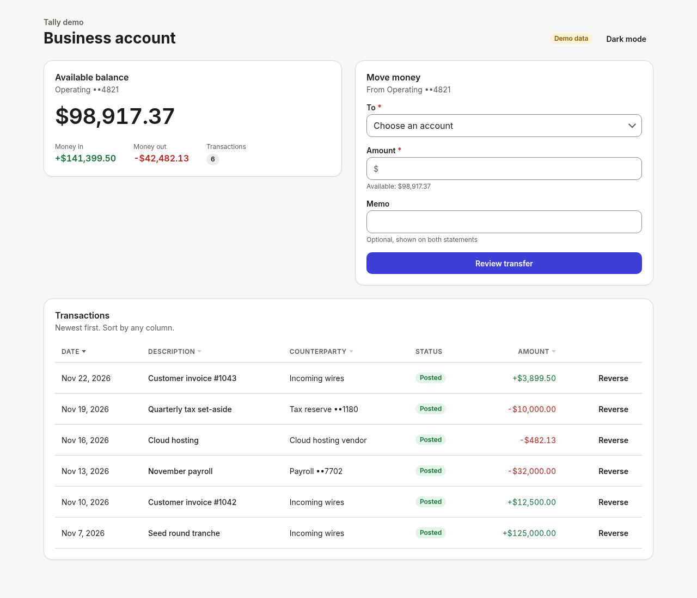
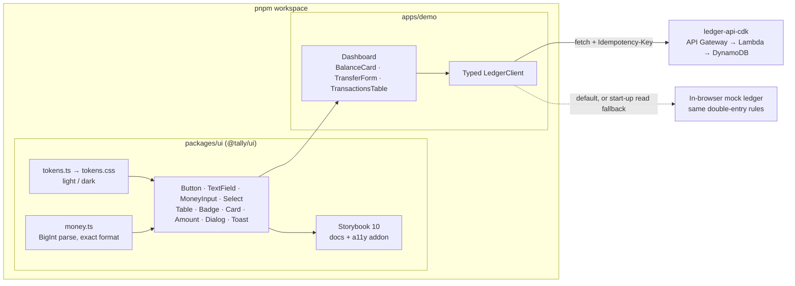

# Tally design system

An accessible **fintech React + TypeScript component library** in the spirit of modern banking
dashboards, with design tokens, exact money handling, Storybook docs, and a demo account
dashboard that talks to a real serverless ledger API
(`ledger-api-cdk`, the companion project).

 

| Light | Dark |
| --- | --- |
|  |  |

<!-- Screenshot placeholders: add a Storybook screenshot and a short screen recording of the transfer flow here. -->

## What it proves

| Concern | How it shows up here |
| --- | --- |
| **Money is never a float** | `parseMoney` works on strings and `BigInt`, `formatCents` hands `Intl.NumberFormat` an exact decimal string. `10.999` is a validation error, not `$11.00`. Locale-aware (`1.234,56 €`, en-IN `12,34,567.89`), with group separators validated against the locale's grouping, so `1,00` in en-US is an error rather than $100.00. Currency-aware (JPY has 0 decimals, BHD has 3), and safe past 2^53 / 100 (formatting relies on `Intl.NumberFormat` v3 exact-decimal input, in all current evergreen browsers). |
| **Accessibility built in, and tested** | Every component test runs **axe-core**. Labels, hints and errors are wired with `aria-describedby`/`aria-invalid`; the table exposes `aria-sort` with keyboard-operable headers; the dialog traps focus, closes on Escape and restores focus; toasts use polite/assertive live regions. Token contrast pairs are checked against WCAG AA in a unit test. |
| **Design tokens as a single source** | `tokens.ts` generates `tokens.css` (light, dark, and `prefers-color-scheme`); a test fails if they drift. |
| **Library engineering** | pnpm workspace, Vite library build (ESM + one CSS file), `.d.ts` output, React as a peer dependency, tree-shakeable exports. |
| **Product thinking** | The demo dashboard has a review → confirm transfer flow with an idempotency key created at review time. If a transfer or reversal times out, the UI never claims success: it says the outcome is unknown and offers **Retry safely**, which resends the *same* key, so neither double-clicks nor retries can double-send. The key is kept until the ledger gives a definitive answer: reviewing identical details again (even after clearing and retyping them) reuses it, while different details get a new key plus a warning that the previous transfer may already have posted. Amounts use the account's currency throughout. |
| **Full-stack story** | The demo's typed client matches the `ledger-api-cdk` contract (integer cents, `Idempotency-Key`, error codes), and the mock enforces the same double-entry rules. |
| **CI** | Lint (ESLint + jsx-a11y + react-hooks), typecheck, tests, library and demo build, and Storybook build on every PR. |

## Architecture



## Components

| Component | Notes |
| --- | --- |
| `Button` | primary / secondary / ghost / danger, three sizes, `loading` sets `aria-busy` and blocks clicks, defaults to `type="button"`. |
| `TextField` | Label, hint and error wiring, decorative prefix/suffix hidden from screen readers. |
| `MoneyInput` | Reports `valueCents: number \| null` only. Edits a plain decimal while focused and formats with grouping on blur. Min/max in cents. |
| `Select` | Styled native `<select>`, so the platform picker stays accessible on every device. |
| `Table` | Generic `Table<T>` with sortable columns (`sortValue`), stable sort, `aria-sort`, row headers, empty state, density. |
| `Badge`, `Card`, `Amount` | Status labels (text carries meaning, not color), labelled card regions, tabular-figure money with sign coloring. |
| `Dialog` | Portal, `aria-modal`, focus trap, Escape, scroll lock, focus restore, `alertdialog` variant. |
| `Toast` | `ToastProvider` + `useToast()`, status vs alert roles, auto-dismiss that pauses on hover/focus. |
| `ThemeProvider` | Toggles `data-theme` for light/dark; defaults follow the OS. |

## Run it

Requires Node.js 20+ and pnpm 10 (`corepack enable`).

```bash
pnpm install
pnpm dev               # demo dashboard on http://localhost:5173 (mock data)
pnpm storybook         # component docs on http://localhost:6006
pnpm lint && pnpm typecheck && pnpm test
pnpm build             # library → packages/ui/dist, demo → apps/demo/dist
pnpm build-storybook   # static docs → packages/ui/storybook-static
```

### Point the demo at the real API (local or private sandbox only)

The demo runs on the built-in mock by default, and a public build of it should stay that way.
To try it against a private `ledger-api-cdk` (for example `npm run synth:demo` deployed to a
sandbox, or a stack behind your own JWT issuer), create a few accounts, then copy
`apps/demo/.env.example` to `apps/demo/.env.local`:

```bash
VITE_USE_LIVE_API=true
VITE_LEDGER_API_URL=<ApiUrl stack output>
VITE_PRIMARY_ACCOUNT_ID=<account id>
VITE_COUNTERPARTY_ACCOUNTS=<id>:Tax reserve,<id>:Payroll
```

The header badge shows **Live API** or **Demo data**. Fallback rules:

- Only an unreachable API on a *read*, before anything live has loaded, switches to the mock. The
  switch is announced in a toast, the badge stays on **Demo data**, and only a reload goes back.
- Writes never fall back. A timed-out transfer may have committed on the server, so the UI shows
  an unknown outcome and retries with the same idempotency key.
- After live data has been shown, nothing falls back, so real and invented balances never mix.
- Business errors such as `INSUFFICIENT_FUNDS` are shown as-is.

`createHttpLedgerClient` accepts a `getAccessToken` callback for an API behind the JWT
authorizer; wiring a sign-in flow is left to the host app.

### Using the library

```tsx
import '@tally/ui/styles.css';
import { MoneyInput, ToastProvider } from '@tally/ui';

<MoneyInput label="Amount" valueCents={cents} onValueChange={setCents} currency="USD" />;
```

## Project layout

```
packages/ui/
  src/tokens/        tokens.ts (source of truth), tests incl. WCAG contrast
  src/money/         exact parsing/formatting + tests
  src/components/    components, *.stories.tsx, components.test.tsx (with axe)
  src/styles/        tokens.css (generated), components.css
  scripts/           build-tokens.ts (pnpm --filter @tally/ui tokens)
  .storybook/        Storybook config, theme toolbar
apps/demo/
  src/api/           types, HTTP client, mock ledger, fallback wrapper, config
  src/components/    BalanceCard, TransferForm, TransactionsTable
```

## Trade-offs and next steps

- `color-contrast` is disabled in jsdom axe runs because jsdom doesn't compute styles; contrast is enforced on token values instead. A Playwright + axe pass on the Storybook build would cover rendered contrast.
- Visual regression testing (e.g. Chromatic or Playwright screenshots) is the obvious next CI step.
- `Select` is native by design; a searchable combobox would be a separate component.

## Author

Glen Burchfield <glen@gmbxdigital.com>

## License

MIT © Glen Burchfield
